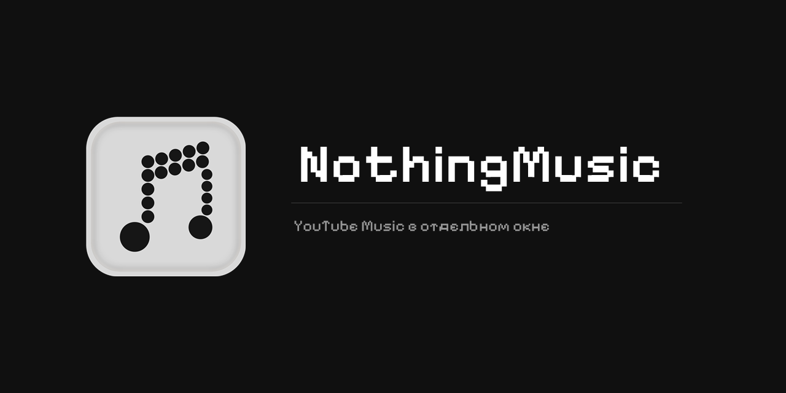

# NothingMusic



## Что внутри

- Своё окно вместо вкладки, работает в трее: закрытие прячет окно, полный выход из меню иконки
- Заголовок свой или системный, тёмная рамка, название окна можно поменять
- Скорость 0.5x-2x с сохранением питча, эквалайзер, «под водой», реверберация
- Размер окна и настройки запоминаются между запусками

## Звук

Настройки открываются кнопкой в заголовке, по `Ctrl+,`, правым кликом по заголовку или из меню трея. Эффекты применяются на ходу, трек перезапускать не нужно.

Скорость, сохранение питча, три полосы эквалайзера (-12..+12 дБ), «под водой» с глубиной, реверберация.

Настройки лежат в `%LOCALAPPDATA%\NothingMusic\settings.json`. Если осталась папка от старой версии (`YouTubeMusic`), она переносится при первом запуске.

## Запуск

Скачать `NothingMusic.exe` из Releases и запустить. .NET ставить не нужно, нужен только WebView2 Runtime (в Windows 10/11 обычно уже есть).

Собрать самому:

```
dotnet publish -c Release -r win-x64 --self-contained true -p:PublishSingleFile=true
```

## Иконки и шрифт

В проекте лежат `logo.png`, `settings.png`, `ico.ico`, `tray.ico` - они вшиваются в exe при сборке. `logos.png` - исходник, из него собраны иконочные файлы.

Заголовки набраны Pixelify Sans (SIL OFL, текст лицензии в `PixelifySans-OFL.txt`). Если убрать `PixelifySans.ttf`, интерфейс вернётся на Segoe UI.

Лицензия - MIT.
